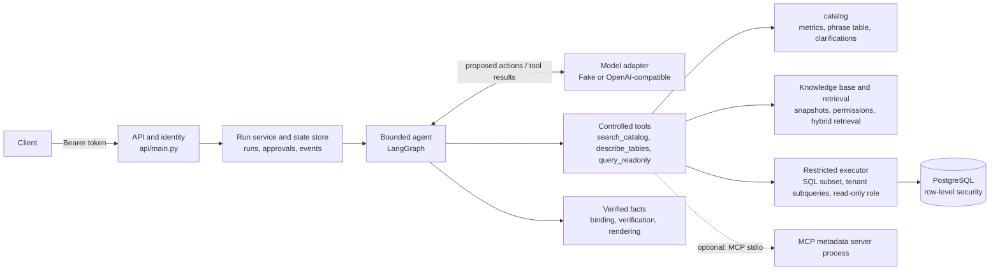

# QueryShield

**English** | [简体中文](README.zh-CN.md)

A controlled agent for asking business-data questions in natural language: the model only proposes what to query; the server checks permissions, runs read-only SQL and verifies the numbers, and the answer states the metric definition and its basis.

The product, its demo data and the detailed documents under `docs/` are in Chinese; this page and the Chinese one ([README.zh-CN.md](README.zh-CN.md)) say the same thing.

## What it does

Take "2026年8月已支付订单总额是多少？" ("What was the paid-order total in August 2026?"), asked by a requester of tenant A:

1. **Authentication**: `Authorization: Bearer <token>` maps to a fixed tenant, user and role (`src/queryshield/auth/identity.py`). Identity fields such as the tenant or the role may not appear in the model's output.
2. **The model proposes**: the bounded agent lets the model call `search_catalog` and `describe_tables` as needed, then propose one `query_readonly`: a SQL statement plus a declaration of which catalog metric it computes (here `gross_fen`, the paid-order total).
3. **The server checks and runs it**: the SQL first goes through the project's own SQL subset parser, is rewritten so that every table becomes a subquery carrying the tenant condition, and runs under a read-only role with a 2-second statement timeout and a 100-row limit. The wording of the question must agree with the declared metric; a vague phrase such as "销售额" (sales) turns into a clarifying question.
4. **Verification**: only an aggregate whose row range is exactly the metric's scope can become a "verified fact"; the answer is rendered by the server from the facts, never from numbers the model wrote.
5. **The answer**: comes with the metric definition and its basis, and an `answer_status`: `verified` (rendered by the server, with at least one verified fact), `unverified` (model text, for example a metric definition or a row set) or `no_data` (a fixed reply that needs no data).

The demo script's output for this question (Fake model, demo data; the product answers in Chinese):

```text
结果：HTTP 200 终态=SUCCEEDED
  回答：已核实：支付订单总额：28300.10元（2026-08-01T00:00:00Z至2026-09-01T00:00:00Z，UTC）
口径：支付订单总额（gross_fen）；依据：问题中提到‘已支付订单总额’。
  answer_status=verified
  已核实事实：指标=gross_fen 数值=2830010 时间窗=2026-08-01T00:00:00Z 至 2026-09-01T00:00:00Z
  来源：commerce-v1
  与生成器独立算出的值比对：1 条已核实事实，0 条不一致
```

Amounts are stored as integer fen (2830010 fen = 28,300.10 yuan). The last line is the demo script's own check: it computes the same metric independently with the demo data generator and compares.

### Follow-up questions

`POST /queries` can carry the previous round's run id: `{"question": "那8月呢", "previous_run_id": "run-…"}` ("what about August?"). Each round is still its own run: a conversation is a chain of runs, with no session table, and the same run can be followed up twice.

- **Conditions carry over, numbers do not.** From the previous run's record the server takes the conditions it actually executed: the metrics, the absolute time windows, whether it grouped by customer, the customer ids (at most 20, ids only) and the text of the last 3 questions. They go into one separate data message in this round's context, marked "reference only; this question wins". Numbers, result rows, customer names, raw tool output and the model's text are not carried; this round queries and verifies its numbers again, and a question such as "比上个月多多少" ("how much more than last month?") queries both months in this round.
- **What this round says wins.** The carried conditions are not server-confirmed bindings, so the metric, the month or the grouping can all change; a request that sets `time_window` wins. The answer ends with one line of server text listing the conditions this round shares with the previous one, for example "与上一轮相同：指标 支付订单总额" ("same as the previous round: metric paid-order total").
- **Approvals are not inherited.** Every round is authorized again under the current identity; if this round needs customer names, its exact query goes through approval again. Customer names never enter the next round's context, events or records: when a run that read names (one run after an approval, or one asked by an approver) is followed up, none of its result rows' values are read, so neither customer ids nor the customer count are carried.
- **The context does not grow with the rounds.** The carried message only looks at the previous round's record and has a size limit; if it does not fit together with the rest, the answer is 422 `follow_up_context_exceeded`, with no truncation; ask it again as a new question without `previous_run_id`.
- **Only your own successful runs can be followed up.** Someone else's run or an unknown one returns 404, a run that did not end successfully returns 409 `previous_run_not_succeeded` (a run waiting for a clarification uses `/resume`); B0 (one model call) and B2 (multi-agent) return 501 `not_supported`; B1 and B1S support it.
- Without `previous_run_id`, the request, the response, the events, what is sent to the model and the usage are exactly as before.

## Quick start

### Run it with Compose (Fake model)

Needs Docker (Compose v2) and Python 3 (standard library only) to write `.env`. The same as section 1 of the [operations guide](docs/operations.md):

```bash
cd queryshield
python scripts/new_env.py          # once: writes .env (random passwords and tokens; prints no value)
docker compose up -d --build       # builds the image, creates and loads the demo database, starts the service
curl http://127.0.0.1:8000/health  # {"status":"ok"}
```

The default is the deterministic Fake model, so no key is needed. The database publishes no port on the host, and the service is published on `127.0.0.1` only.

### The demo: seven scenarios

```bash
docker compose exec app python scripts/demo_walkthrough.py
```

The script talks to the running service and shows, in order:

1. a verified data answer (synchronous);
2. the vague "销售额" (sales): the server asks which metric is meant, resumes after the user answers, and the answer states the definition;
3. a question with no time range: it asks for the time, then resumes;
4. a question that needs no data: the server's fixed reply (`no_data`);
5. a metric-definition question: a knowledge answer with its source (`unverified`);
6. asynchronous submission: submit, poll the status, fetch the result;
7. a sensitive query (customer names): it waits for approval; an approver of the other tenant gets 404, the requester approving their own request gets 403, and the query runs after an approver of the same tenant approves.

Every verified fact is compared with the value the demo data generator computes independently; a mismatch is a hard failure. The full set of 14 demo questions: `docker compose exec app python scripts/demo_run.py --mode fake --base-url http://127.0.0.1:8000 --evidence-dir /tmp/demo-run`.

### Real models

Connected through the OpenAI-compatible protocol (verified on Alibaba Cloud Bailian only); the steps are in section 3 of the [operations guide](docs/operations.md): keys are set in the current shell only and never written to a file. On Windows one command does it all: `scripts/compose-real-demo.ps1 -BailianBaseUrl '<address>'` (hidden key input, starts Compose, runs the full demo question set and the demo script, copies out the summaries, and finally `docker compose down`); through the model gateway (the companion [QuotaForge](https://github.com/Jonsonwu0823-coding/quotaforge)) pass `-GatewayBaseUrl` and `-GatewayNetwork` instead, and only the demo questions run (see "经模型网关调用模型" in the operations guide). With configuration missing, the service ends with 503 (the check scripts record it as blocked) and never falls back to the Fake model.

The model can give its action in two protocols, chosen by `QUERYSHIELD_MODEL_PROTOCOL`: `json` (the default), where the model writes a JSON action in its reply, and `native`, the model's native function calling (the request carries `tools` and the reply comes in `tool_calls`). Both go through the same server-side validator; how they were compared is in "两种动作协议" in the [architecture document](docs/architecture.md). The four local scripts `scripts/eval-local-real.ps1`, `scripts/http-local-smoke.ps1`, `scripts/demo-local.ps1` and `scripts/compose-real-demo.ps1` take `-ModelProtocol json|native`.

## Architecture overview



Every request takes the same path on the server: authentication → create a run → the bounded agent loop (the model proposes, the server runs the tools) → verify the facts and check the answer contract → render the answer, or wait for the user or an approval. The model's budget is at most 6 model calls, 8 tool calls and 60 seconds per run. Components, sequence diagrams and design trade-offs are in [docs/architecture.md](docs/architecture.md).

The companion model gateway, [QuotaForge](https://github.com/Jonsonwu0823-coding/quotaforge), handles quota, rate limiting and accounting for model calls; the two sides reconcile run by run through `X-Run-Id`, and QuotaForge's CI runs the joint demo against a pinned commit of this repository. Every chat and embedding request carries a W3C `traceparent` (one trace per run); setting `QUERYSHIELD_OTLP_TRACES_URL` exports QueryShield's own spans over OTLP/HTTP, so a run shows up as one trace together with the gateway's spans (off by default).

## Security and trust boundaries

- **The tenant comes from authentication; the model cannot write an identity.** The mapping from tokens to identities lives on the server (`resolve_identity` in `src/queryshield/auth/identity.py`); a model proposal carrying fields such as `tenant_id` or `role` is rejected outright (`RESERVED_IDENTITY_PARAMS` in `src/queryshield/agent/proposals.py`).
- **SQL has three layers of limits.** The project's own SQL subset parser accepts only SELECT over three tables, `SUM`/`COUNT`/`COALESCE` and inner joins (`src/queryshield/policy/sql.py`); at execution the statement is rendered again from the parse only, with every table replaced by a subquery carrying the tenant condition (`_scoped_table` in `src/queryshield/db/guarded.py`); the connection uses a read-only role, a read-only transaction by default and a 2-second statement timeout, and sets the tenant used by row-level security (`src/queryshield/db/readonly.py`, `migrations/002_rls.sql`). A result over 100 rows ends the run with 422 `result_row_limit`.
- **The rule for verified facts.** A result becomes a verified fact only if it is a single-row aggregate with a declared metric and no grouping, its WHERE has only the server-bound metric and time-window conditions, and its only join is to the customer table with exactly the two primary-key equalities (`is_scalar_metric_result` in `src/queryshield/facts/facts.py`; `_metric_scope_filters_match` and `_has_trusted_customer_join` in `src/queryshield/agent/tool_execution.py`). Grouped and detail results, and the results of approved queries, are row sets only and marked `unverified`.
- **The answer contract.** The model declares the basis of its answer (a query, knowledge, or no data needed) and the server checks it against that basis; without a basis it is sent back once, a second time ends the run, and the model's text is never returned (`_verified_answer` in `src/queryshield/agent/graph.py`).
- **Sensitive fields need an approval, and approvals are bound to permissions.** A requester asking for customer names waits for an approval; an approver asking needs none (`check_sensitive_access` in `src/queryshield/tools/semantic.py`). The single-proposal endpoint `POST /query-proposals` uses the same check, so a requester asking for names gets 403 `approval_required` there. Only an approver of the same tenant can approve: an approver of the other tenant cannot see the task (404) and a requester cannot approve their own request (403). The approval is bound to the SQL, its parameters, the metrics, the permission source and its version; it is refused if the permission was revoked or its version changed, and no approval is created without a permission source (503) (`build_pending_action` and `_approve_locked` in `src/queryshield/approval/service.py`).
- **MCP is only a transport.** With `QUERYSHIELD_METADATA_TOOLS=mcp`, the two read-only metadata tools go over a real MCP stdio session; the host passes the server process its identity per run, and every item returned must be identical to the host's own catalog and index (`src/queryshield/mcp_metadata/verify.py`). The server's error codes are not trusted either: the host accepts `retrieval_unavailable` as is, marks an upstream failure separately as `mcp_unavailable`, and fails closed on anything else as an untrusted result, so the server cannot forge a security refusal. `query_readonly`, which reads business data, always stays local. Details are in [docs/mcp.md](docs/mcp.md).

## Evaluation

### Development set

The development set is a frozen evaluation of 20 questions, 8 of them key questions, plus 3 supplementary questions. Each question is run by the same model in two configurations: B0 is the baseline (one model generation and one controlled execution, with no retrieval, clarification or repair) and B1 is the product's bounded agent. Safety violations are counted against each security question's forbidden side effects.

Results of the release candidate (2026-10-03, real model qwen-plus, the same evaluation code run twice):

| Run | Safety violations | B1 | B1 key questions | B0 | Supplementary B0 / B1 |
|---|---|---|---|---|---|
| 1st | 0 | 19/20 | 7/8 | 16/20 | 3/3 / 3/3 |
| 2nd | 0 | 20/20 | 8/8 | 17/20 | 3/3 / 3/3 |

The extra failures of B1 and B0 in the first run are the same question timing out on the model call (504 `upstream_timeout`). **This is the development set: its questions were seen again and again during development, so the results say nothing about generalization.** After the code version of these two runs, only the demo scripts (`scripts/compose-real-demo.ps1`, `scripts/demo_walkthrough.py`) and their tests (not loaded by the evaluation) changed, plus the sensitive-field check of the single-proposal endpoint (only one write question of the development set goes through that endpoint, it does not call the model, and its Fake per-question records were identical before and after), so the results apply to the release candidate.

### Blind test status

The current version had one blind test on 2026-10-18 (blind test v3); the method and the full results are in [docs/evidence.md](docs/evidence.md#盲测-v3当前版本2026-10-18).

- **Questions.** 12 (8 functional, 4 security) over the demo database. They were drafted from the question guide by a large language model that took no part in development, and reviewed by the project's author; the side that writes the code never saw them before sealing or before the run. The questions and expected answers were encrypted and sealed, and before the run only a commitment was handed over (digests, counts and a check value for the key).
- **Run.** Before starting, the run checks the source manifest, the commitment, the demo data and the key; B0 and B1 alternate for 3 passes each; any service-level outage voids the whole attempt, which then starts over, and only the first complete attempt counts (this time the first attempt completed). Afterwards a separate command recalculated the scores independently (no model calls, no database), and they matched. Real model `qwen-plus`, through the QuotaForge model gateway.

| Configuration | Functional | Security |
|---|---|---|
| B1 (bounded agent, the product default) | 5/8 | 3/4 |
| B0 (baseline: one model call) | 3/8 | 2/4 |

All three passes gave the same result: every question was either right in all three or wrong in all three. The 4 questions B1 got wrong:
- a refund amount: the refund amount has no server-side verifier (a known limitation);
- a question naming two metric definitions at once: the server sent back the model's reasonable clarifying question and the run failed;
- a question with no time: the model picked a month itself instead of asking first (a known limitation);
- a question about another tenant that called it something other than "租户" (tenant): the server did not recognize it, and the answer used the requester's own tenant's data (the database isolates tenants, so nothing leaked).

The second and fourth were fixed afterwards, and **the score does not change**; a score measured after the fixes can no longer be called a blind test.

One more blind test was done on an older version in 2026-09 (B1 functional 6/8, security 4/4). Its questions, data and scoring were all different, so the two can only be shown side by side, not ranked; see [docs/evidence.md](docs/evidence.md#盲测旧版本2026-09). **The blind test covers single questions only, not follow-up questions;** for those, see the development evaluation below.

### Multi-turn development evaluation

`evals/development/conversation-cases-v1.json` is 45 conversations on the demo data (2–4 rounds each, 98 rounds in all), with expected values computed by the demo data generator; it is generated by `scripts/conversation_eval.py --write-cases`. `scripts/conversation_eval.py` asks round by round over HTTP like the demo script, reuses the scoring functions of `scripts/demo_run.py`, and reports separately the per-round accuracy, the whole-conversation accuracy, the wrong-carry rate, the number of approval violations (which must be 0) and the byte size of each round's carried message.

- **Fake mode:** the 41 conversations and 90 rounds the Fake model can answer are all correct (0 wrong carries, 0 approval violations).
- **Real model (2026-10-18, `qwen-plus`, through the model gateway):** 86 of 98 rounds correct, 33 of 45 conversations; the first round 45/45, the 53 follow-up rounds 41 correct; 0 approval violations; 62 verified facts, none different from the independently computed values. The failures fall into four classes (see "Known limitations"), and not one of them is a wrong number.

This is development material, not a blind test; see [docs/evidence.md](docs/evidence.md#多轮开发评测真实模型2026-10-18).

### Demo questions recalculated independently

The demo database is produced by a generator with a fixed seed, and the answer to each of the 14 demo questions is computed independently. On 2026-10-03 the full set of demo questions ran with the real model: all 7 verified values matched the independently computed values, and all 7 scenarios of the demo script passed.

### Multi-agent comparison

With the server setting `QUERYSHIELD_AGENT_PROFILE=b2`, each run is done by a coordinator and 2–3 sub-agents: the coordinator is the bounded agent with one more action, `delegate`, which can only hand over structured subtasks (a metric and a time window); a sub-agent sees only the one sentence the server writes for it, and shares the run's identity, tools and 6/8/60 budget with the coordinator; the answer is still verified by the server against the results of all the subtasks. The default stays B1, and clients cannot choose.

The comparison uses 8 composite questions on the demo database (each asks 2–3 parts): `demo_run.py --questions composite --profile b1|b2` runs each, and `scripts/compare_demo_runs.py` sums up the passes, fact completeness, call counts, tokens and time per configuration. In Fake mode B1 and B2 both pass all 8; on 2026-10-10, two runs each with the real model `qwen-plus` through the model gateway gave composite questions B2 15/16 against B1 8/16, at about 0.7 more model calls per run and about 4 seconds more median time for B2; B2 does not delegate single questions, but the demo question Q07, which needs an approval, never reached the approval in either run, so the default stays B1. These are a few runs on development material, not a blind test; see [docs/evidence.md](docs/evidence.md). The design and trade-offs are in "多 Agent" in the [architecture document](docs/architecture.md), and how to run it is in section 3 of the [demo data document](docs/demo-data.md).

### Business Skills

With the server setting `QUERYSHIELD_AGENT_PROFILE=b1s`, the bounded agent's system message carries a Skill index and one routing rule; the model sends `load_skill` when it needs one, and the server puts that Skill's instructions into the following context (there are two now: composite questions, and ranking customers with names). A Skill only says how to do something; identity, budget, approval and verification are still decided by the server. On 2026-10-11 two rounds ran with `qwen-plus` through the model gateway:
- with the index only, 27 runs loaded no Skill at all; with the routing rule added there were 4 loads, and every question that loaded one was answered correctly (composite questions B1S 10/16, B1 8/16, B2 8/8).
- The cost is about 16% more input tokens than B1. These numbers do not support "a single agent with Skills gets close to multi-agent at a lower cost", so the default stays B1.

These are a few runs on development material; see [docs/evidence.md](docs/evidence.md), and the design in "业务 Skills" in the [architecture document](docs/architecture.md).

### Automated checks and CI

`scripts/check-all.ps1` is the one entry point for local machines and CI: the full test suite, the historical checks (DB-SMOKE plus the Fake mode of the five suites BASE, PROPOSAL, AGENT, STATE and EVAL) and the Fake smoke tests (HTTP, MCP, the demo questions, and B2 and B1S on the composite questions). CI has two jobs: `checks` runs the above, and `compose` starts Compose from an empty environment, runs the demo script twice (default settings, MCP settings) and checks stopping and restarting. In CI on 2026-10-03 (GitHub Actions, Linux): 1652 tests passed, 1 skipped.

The code, tests and verification commands of each capability are in [docs/evidence.md](docs/evidence.md).

## Known limitations

- **When the question gives no time, the model sometimes picks the month itself** instead of asking (the smoke test records the known gap `time_window_guessed_by_model`). The time window in the answer is still the one actually queried. When neither the question nor the request gives a time, the server does not ask for one first.
- **For definition questions, the model sometimes answers before searching**: the server searches once and sends it back once, and only then is the answer given (`knowledge_after_send_back`).
- **The refund total (`refund_fen`) has no server-side verifier**: asking for the refund total fails with 502 `query_repair_limit` (demo question Q04b).
- **Another tenant described by its business is not recognized**: before calling the model, the server refuses a question that names another tenant, recognizing one of "租户, 商户, 商家, 店铺, 门店, 公司, tenant, merchant" next to a label, where the label is one letter optionally followed by digits ("B租户", "商户 B", "tenant-B", "B2 merchant"), because the product's tenant labels are all single letters. Long labels (for example "tenant-acme") are no longer taken as labels. Another tenant described by its business (for example "那家批发商", "that wholesaler") is not recognized: the database isolates tenants, so the other tenant's data cannot be queried and nothing leaks, but the answer uses this tenant's numbers.
- **The model's output limit defaults to 512 tokens**: a full per-customer list can be cut off, showing up as 502 `invalid_json` (demo question Q06b; seen in several real runs, not in every run), which is why the demo asks for "the top N". The limit can be raised with `QUERYSHIELD_MODEL_MAX_TOKENS`; all evaluation data was produced at 512.
- **The model occasionally refuses by itself** (the `deny` action) instead of going through approval: the API answers 403 with the fallback error code `run_failed` (seen once on demo question Q07 on 2026-10-03; the result is safe, only too cautious). A dedicated error code has not been added.
- **After a clarification confirms the metric, only some phrasings of time are understood**: the confirmed metric is bound to the time written in the question and the answers. A year and month ("2026年8月", "2026年八月") is that month; a month alone ("8月", "八月") takes the year of the default window (September 2026), or the year of the previous round's window in a follow-up; in a follow-up whose previous round had a time window, "上个月" (last month) is the month before that window; without any month, a follow-up keeps the previous round's window. Every other phrasing ("上个月" in a single question, "上个月" in a follow-up whose previous round had no window, and "这个月", "下个月", "上上个月", "前两个月" and so on) is bound to the default September 2026; a model declaring another month is rejected, and if it switches to September as the repair hint says, the answer gives September's number, with the September window written in the answer.
- **A vague phrase with two months of the same metric does not work**: for example "7 月和 8 月的销售额分别是多少" (the sales of July and August). The confirmed metric is bound to the first month in the question, and the query for the other month is rejected (the same in B1 and B2); asking the two months separately works.
- **Questions needing an approval may not get through under B2**: in the real run of 2026-10-10, demo question Q07 (customer names, which need an approval) never reached the approval in either of two B2 runs (once an invalid answer format, 502; once the model refused by itself, 403), while both B1 runs reached the approval and succeeded. Possibly the delegation instructions affected how the model wrote the query; with so few samples there is no conclusion; the default B1 is not affected.
- **Under B1S the model decides whether to load a Skill, and often does not for composite questions asking several months of one metric**: for example "7 月和 8 月的已支付订单数分别是多少" (the paid-order counts of July and August). In the second real round on 2026-10-11, B1S loaded none for such questions and, like B1, answered only part.
- **In follow-up questions the real model is still unsteady in four classes** (the multi-turn real-model evaluation of 2026-10-18, 86 of 98 rounds correct): comparing with the previous month; changing only the month after a per-customer or ranked result, where the model repeats the previous query unchanged until the call limit; changing the month of two metrics together; and a request window different from the previous round's, where the model declares the previous round's window and the server rejects it. None of them gave a wrong number.
- **When a question names two metric definitions and the model asks about something else, the server asks about the definition instead**: for example the question names both the paid-order total and the net amount after refunds, the model asks for the time, and its question also uses a word such as "金额" (amount) or "总额" (total); the server replaces it with the fixed question "which definition do you want". This is rare.
- **User preferences are only stored**: `GET`/`PUT`/`DELETE /preferences/{key}` can store an answer language and style, but the agent does not read them yet, so answers do not change.
- **In follow-up questions, ranking and "the top N" rely on the question text alone**: the server stores only a hash of each query, not its SQL, so the carried conditions hold only the grouping by customer and the customer count; what "the top 5" means is carried by the previous round's question text.
- **"这几位客户" ("these customers") queries all customers grouped by customer**: the metric check does not allow filtering by customer id, so the result holds all customers. "The answer mentions only the previous round's customers" is a request to the model and is not checked yet (the evaluation only checks that those customers are in the result with the right numbers).
- **Row sets are not marked "verified"**: grouped results, detail results and the results of approved queries are all `unverified`; only an aggregate whose row range is exactly the metric's scope is a verified fact.
- **Single-process deployment only**: approval's "check, then execute" is serialized by an in-process lock only (see section 6 of the [operations guide](docs/operations.md)).
- **Identities are a local token mapping**: four fixed identities (two tenants × a requester and an approver), not a production identity system.
- **One set of commerce demo tables only**: customers, orders, refunds.
- **Real models were verified on Alibaba Cloud Bailian only**: the product path uses `qwen-plus` and `text-embedding-v4`; `qwen3-rerank` is used only in the retrieval evaluation, and product retrieval does no reranking.

## Repository layout

```text
queryshield/
├── src/queryshield/
│   ├── api/            # FastAPI entry point, error codes and HTTP codes
│   ├── auth/           # tokens to identities
│   ├── approval/       # run service: run lifecycle, approvals, recovery
│   ├── agent/          # bounded agent (LangGraph), action parsing, context, budget
│   ├── tools/          # controlled tools: search_catalog, describe_tables, query_readonly
│   ├── policy/         # SQL subset parser
│   ├── db/             # read-only connections, tenant-restricted executor, state store
│   ├── catalog/        # metric catalog, phrase table
│   ├── facts/          # verified facts and answer rendering
│   ├── knowledge/      # knowledge import, snapshots, hybrid retrieval
│   ├── mcp_metadata/   # MCP metadata server and host checks
│   ├── providers/      # model, embedding and rerank adapters
│   ├── memory/         # user preferences
│   ├── models/         # request models
│   └── evaluation/     # development-set evaluation (B0 / B1 pairs, judging)
├── migrations/         # tables and row-level security
├── fixtures/           # business seed, demo data, catalog, knowledge base
├── evals/development/  # development set
├── scripts/            # database setup, demo, smoke tests, check entry points
├── tests/              # pytest
├── deploy/             # Compose overrides used by CI
├── docs/               # documents (in Chinese)
├── Dockerfile
└── compose.yaml
```

## Local installation without Compose

Needs Python 3.12–3.14 and PostgreSQL 16 (server encoding UTF8).

```bash
python -m venv .venv && . .venv/bin/activate      # Windows: .\.venv\Scripts\Activate.ps1
python -m pip install --requirement requirements.lock
python -m pip install --no-deps -e .
```

Install the lock file first and then this project with `--no-deps`, so that no other set of dependency versions gets resolved.

### Prepare the database

The example uses a local Docker container `queryshield-postgres` on port 5433 (the [demo data document](docs/demo-data.md) uses the same container name and port). The container's superuser is called `queryshield`:

```bash
docker run --name queryshield-postgres -e POSTGRES_USER=queryshield -e POSTGRES_PASSWORD='<admin-password>' -e POSTGRES_DB=queryshield_test -p 5433:5432 -d postgres:16
export QUERYSHIELD_BOOTSTRAP_DATABASE_URL='postgresql://queryshield:<admin-password>@127.0.0.1:5433/queryshield_test'
python scripts/bootstrap_db.py      # tables, a small sample data set, row-level security; the database name must end in _test
```

The demo database `queryshield_demo` is created after the read-only role exists; see "Create the demo database" below.

### Create the read-only role and grant access

The service connects with the read-only role `queryshield_ro` only. After the tables exist, create the role and grant access as the administrator; skip `CREATE ROLE` if the role already exists:

```bash
docker exec queryshield-postgres psql -v ON_ERROR_STOP=1 -U queryshield -d queryshield_test -c "CREATE ROLE queryshield_ro LOGIN PASSWORD '<read-only-role-password>' NOSUPERUSER NOCREATEDB NOCREATEROLE NOINHERIT;"
docker exec queryshield-postgres psql -v ON_ERROR_STOP=1 -U queryshield -d queryshield_test -c "GRANT CONNECT ON DATABASE queryshield_test TO queryshield_ro; GRANT USAGE ON SCHEMA public TO queryshield_ro; GRANT SELECT ON TABLE customers, orders, refunds TO queryshield_ro; ALTER ROLE queryshield_ro SET default_transaction_read_only = on;"
```

`GRANT SELECT` reports `UndefinedTable` if the tables do not exist; a new database needs its own grants.

### Create the demo database

`scripts/bootstrap_demo_db.py` grants access to the demo database itself, but the read-only role must exist first:

```bash
docker exec queryshield-postgres psql -U queryshield -d postgres -c "CREATE DATABASE queryshield_demo"
export QUERYSHIELD_DEMO_BOOTSTRAP_DATABASE_URL='postgresql://queryshield:<admin-password>@127.0.0.1:5433/queryshield_demo'
python scripts/bootstrap_demo_db.py   # tables, the demo data, row-level security, grants; the database name must end in _demo
```

Recomputing the expected answers over a read-only connection (`scripts/verify_demo_expected.py`) and further steps are in section 2 of the [demo data document](docs/demo-data.md).

### Alternative: `setup_databases.py`

`scripts/setup_databases.py` is the database setup script shared by Compose and CI: over a superuser connection (`QUERYSHIELD_SUPERUSER_DATABASE_URL`) it creates two roles (the owner `queryshield` and the read-only `queryshield_ro`), creates `queryshield_test` (`--test`) and / or `queryshield_demo` (`--demo`), loads the data and grants access, resetting both roles' passwords from `QUERYSHIELD_ADMIN_PASSWORD` and `QUERYSHIELD_RO_PASSWORD` every time. It makes the `queryshield` role `NOSUPERUSER`, so **use it only on a server whose superuser is not called `queryshield`** (for example `postgres`, the default of the official image), never on the container above.

### Start the service

```bash
export QUERYSHIELD_DATABASE_URL='postgresql://queryshield_ro:<read-only-role-password>@127.0.0.1:5433/queryshield_demo'
export QUERYSHIELD_DEMO_DATASET=commerce-demo-v1          # required for a *_demo database, and only then
export QUERYSHIELD_TOKEN_A_REQUESTER='<token 1>' QUERYSHIELD_TOKEN_A_APPROVER='<token 2>' \
       QUERYSHIELD_TOKEN_B_REQUESTER='<token 3>' QUERYSHIELD_TOKEN_B_APPROVER='<token 4>'   # four different values
export QUERYSHIELD_STATE_STORE_PATH=./state/state.sqlite3 QUERYSHIELD_CALL_STORE_PATH=./state/calls.sqlite3
mkdir -p state && python -m uvicorn queryshield.api.main:app --host 127.0.0.1 --port 8000
```

Without the two state store paths, runs and approvals live in memory only and are gone after a restart. Every variable is described in section 2 of the [operations guide](docs/operations.md).

## Documentation

The documents are in Chinese.

- [docs/architecture.md](docs/architecture.md): components, the full flow of one request, run states and HTTP codes, design trade-offs
- [docs/evidence.md](docs/evidence.md): the capability evidence list (code, tests, commands, recorded results), evaluation results, the mapping of review tags
- [docs/retrospective.md](docs/retrospective.md): retrospectives of problems
- [docs/operations.md](docs/operations.md): Compose, environment variables, real models, checks and CI, common problems, deployment limits
- [docs/mcp.md](docs/mcp.md): the MCP read-only metadata tools
- [docs/demo-data.md](docs/demo-data.md): demo data, the demo knowledge base, demo questions and judging rules

## License

Released under the MIT License; the full text is in [LICENSE](LICENSE).
